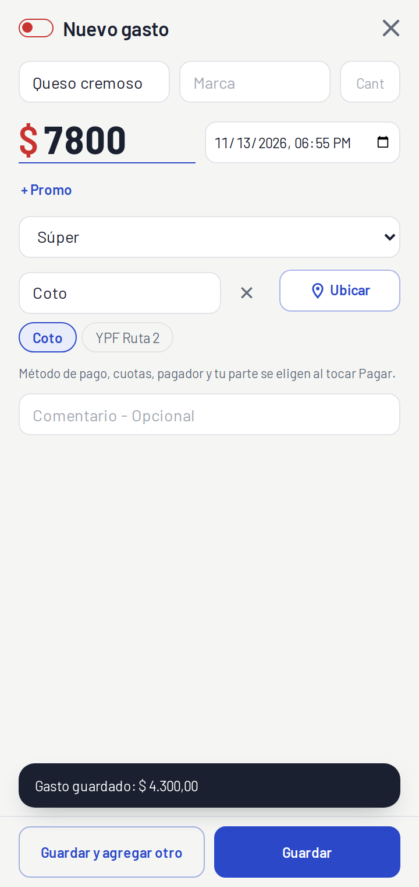
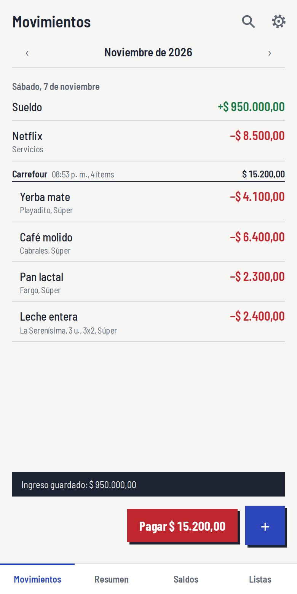
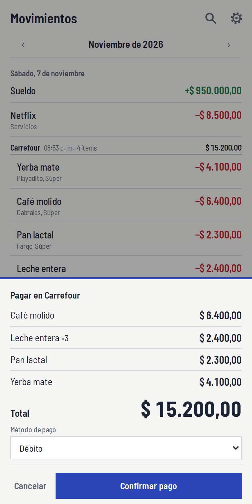
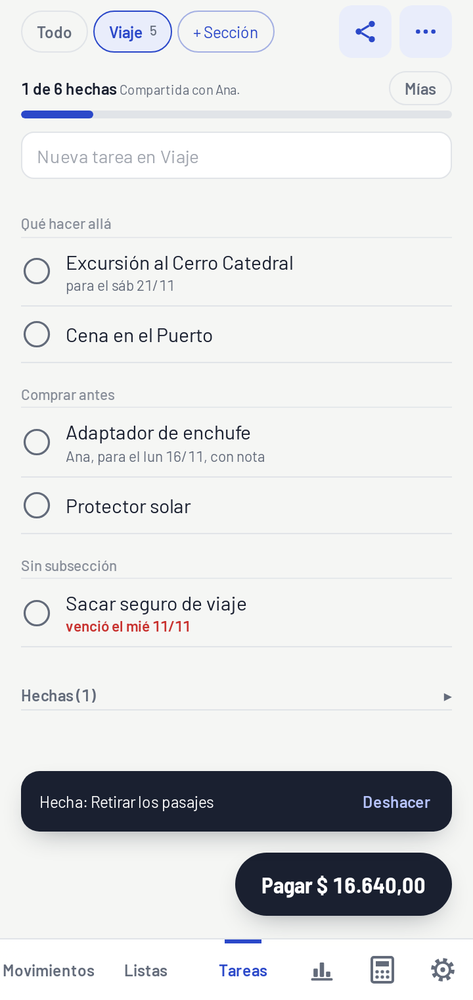

<p align="center">
  
</p>

<h1 align="center">BillIs</h1>

<p align="center">
  Gastos e ingresos en segundos, desde la pantalla principal de tu Android.<br>
  <a href="https://juale86.github.io/BillIs/"><strong>juale86.github.io/BillIs</strong></a>
</p>

---

BillIs es una aplicación web progresiva (PWA) para registrar gastos e ingresos personales con la menor fricción posible: el ícono abre directo en "nuevo gasto", el lugar y el pagador se recuerdan, el último precio de cada producto se precarga y una compra completa se paga una sola vez al final, como en la caja del súper.

Los gastos se guardan **solo en el teléfono**. Lo único que pasa por internet son las **listas de compras** y las **tareas** compartidas, que usan Firebase.

<p align="center">
  
  
  
  
</p>

## Funcionalidades

### Carga rápida
- **Gasto o ingreso** con un interruptor (solo al cargar uno nuevo; al editar o comprar de la lista el tipo queda fijo); formulario compacto, sin títulos: cada campo se explica con un ejemplo.
- **Producto, marca y cantidad** en una línea (la cantidad vacía vale 1 y al tocarla se selecciona para pisarla); el "Siguiente" del teclado salta al precio; **autocompletado** de producto y marca desde el historial, con el **último precio pagado** precargado (por producto, marca y lugar). Las sugerencias buscan desde el principio de cada palabra: "pan" sugiere "Pan lactal", no "Compañero".
- **Lugar, fecha y pagador** se recuerdan entre cargas; el botón **Ubicar** toma la posición del GPS y, si ya compraste cerca, completa el lugar solo; la categoría se va completando mientras escribís el producto (por lo ya cargado, por el lugar o adivinándola por el nombre, como el grupo en la lista); las marcas ya compradas aparecen como chips dentro del campo Marca.
- **Promociones**: NxM (3x2), N-ésima unidad con descuento (2ª al 70 %), porcentaje y "otra" con total manual; muestra el precio por unidad y el ahorro.
- **Cuotas** en pesos: cargás el total financiado o el valor de cada cuota y se reparte por mes; calcula el interés.
- **Montos con puntos de miles** mientras escribís (1.250.000), y la letra se achica para que el número entre entero.
- Si cerrás el formulario con algo escrito, pregunta antes de descartarlo.
- **Pesos y dólares** (opcional), con totales separados por moneda.

### Compras y "Pagar"
- Cada gasto que cargás se suma a la **compra** en curso; el formulario solo pide qué compraste y cuánto salió.
- Si el gasto empieza una compra (no hay otra en curso), el botón principal es **Guardar y pagar** y abre Pagar enseguida: un gasto suelto se carga de una vez. Para varios productos, **Guardar y agregar otro** y al final **Pagar**.
- El botón **Pagar** muestra el ticket y su total, y es un formulario donde se eligen **método de pago, cuotas, pagador y tu parte** una sola vez para toda la compra. El pagador se elige de un desplegable con vos, las personas que ya cargaste y quienes comparten tu lista; **Otra persona…** pide un nombre nuevo (para "pagó mi pareja y le debo la mitad").
- Los formularios se cierran sin guardar con la **X** de arriba a la derecha.
- En Movimientos cada compra (terminada o en curso) muestra su **Total** con cómo se pagó; tocándolo se corrige el pago de toda la compra.

### Deudas compartidas
- Campo **pagador** y **mi parte** (todo, mitad, nada o %): si pagó otra persona, le debés tu parte; si pagaste vos y compartís, te deben la diferencia.
- **Saldos con personas** dentro de Resumen (solo aparece si hay deudas), por moneda, con registro de pagos para saldar.

### Listas de compras compartidas
- **Varias listas** (súper, ferretería, un cumpleaños), cada una con su propio link para compartir.
- Inicio de sesión con **Google**; quien abre el link **pide unirse** y el dueño **aprueba**.
- El dueño renombra (lápiz) y borra (✕, con confirmación) cada lista desde el menú, la cierra y **da permisos** a cada miembro: por defecto solo agregar; con un toque, también comprar o editar todo. Cerrada, solo el dueño corrige sus ítems.
- Dos campos siempre a la vista: **Agregar a la lista** (con cantidad, marca y grupo) y **Buscar y filtrar**, que busca solo entre lo pendiente y filtra por quién lo agregó.
- **Agregar** pone el ítem arriba; **Agregar y comprar** además abre el gasto, para lo que encontrás en el súper sin tenerlo anotado.
- Cada ítem en un renglón: producto, marca y cantidad (`x2`) pegados, igual que en Movimientos; los chips de grupo tienen todos el mismo ancho; el **lápiz** abre el formulario con sus datos para corregirlos y la **✕** lo quita, con **Deshacer**.
- Tres órdenes que se alternan con un botón: **manual** (arrastrando ≡, lo último primero), **alfabético** y **por grupos** de compra (Almacén, Bebidas, Frescos, Carnicería, Verdulería, Congelados, Mascotas, Limpieza, Herramientas). El grupo se adivina por el nombre, se corrige con un toque y se recuerda. Los grupos se renombran, borran y agregan desde Ajustes.
- Tocar un ítem abre el formulario de gasto con todo precargado; al guardar pasa a **Comprados** con su monto, visible para todos. Tocar un comprado abre su gasto y el botón − lo devuelve a pendientes.
- El dueño **corrige lo que compró otro miembro** con el mismo formulario de gasto completo (en la lista con el lápiz, o en Movimientos tocando el renglón gris). Debajo de cada campo cambiado ve lo que había cargado esa persona, siempre contra lo primero que cargó; la corrección se aplica también al gasto en el teléfono de quien compró.
- **Total** de la lista en vivo, siempre visible abajo; al lado, **Cerrar lista** la archiva y ofrece empezar otra con lo que quedó pendiente. También se cierra cuando el dueño paga la compra, y si quedó de otro día pregunta si empezar una nueva.
- Funciona **sin señal** y se sincroniza al volver la conexión.

### Tareas
- Pestaña **Tareas** con **secciones** (por ejemplo Viaje o Casa) y, dentro de cada una, **subsecciones** (Qué hacer allá, Cosas para buscar, Comprar antes). **Todo** muestra todas juntas.
- Cada tarea tiene **responsable**, **fecha límite** (las vencidas en rojo, las de hoy resaltadas) y **nota**; se tilda con un toque, queda quién la hizo y se puede deshacer. Subsección, responsable y fecha se eligen en un botón desplegable a la derecha del campo para agregar. Arriba, cuántas van hechas, y el chip **Mías**.
- Cada sección se **comparte** por link como las listas (piden unirse y el dueño aprueba; el menú ⋯ de la sección muestra un punto rojo mientras haya pedidos), o se deja solo para vos. Permisos: agregar y tildar por defecto; editar las de otros, si el dueño lo da.

### Historial de cada gasto
- Al abrir un gasto se ve quién lo cargó y cuándo, quién hizo el último cambio y cuándo, y qué cambió (antes tachado, después). Mientras editás, debajo de cada campo cambiado aparece lo que se había cargado.

### Consulta
- **Movimientos** del mes agrupados por día y por compra (las flechas saltan entre los meses que tienen movimientos): la última compra se ve abierta y las anteriores plegadas, con su total y su categoría en chico (si es de un solo producto, se titula con lo que compraste, "Carga SUBE", y el lugar pasa al renglón chico); edición y borrado con deshacer. Si guardás algo con fecha de otro mes, el aviso lo dice ("Gasto guardado en octubre") y su botón **Ver** te lleva a ese mes. Si algo falla (sin conexión, un respaldo que no es de BillIs) lo dice el aviso de abajo, con un punto rojo, sin ventanas que frenen la pantalla; las confirmaciones y los nombres se piden en un diálogo de la app, no en las ventanitas del navegador. Cada compra abierta tiene su propia **lupa** y su **orden** (como se cargó, A..Z o por grupos), y muestra también lo que otros compraron de la misma lista compartida, con el total real y "Solo lo tuyo".
- **Resumen** mensual (el ícono de barras de abajo): ingresos, gastos (solo tu parte), balance, gastos por categoría, cuotas pendientes y saldos con personas.
- **Búsqueda** en movimientos y en las listas, con filtros por chip: los aplicados pasan a la izquierda con ✕ y siguen visibles.
- **Calculadora** al lado del engranaje: + − × ÷ %, paréntesis, coma decimal, C y borrar uno. Se apoya sobre las pestañas, muestra el resultado mientras escribís y tocando afuera se cierra recordando la última cuenta; sin historial. A la izquierda del = está el **conversor de moneda** (pesos, reales y dólares): los dos montos en una línea, "500 🇦🇷 ≈ 1,81 🇧🇷", con banderas dibujadas que abren las otras monedas; tocando el de la derecha convierte al revés. Las cotizaciones se cargan en Ajustes como "1 US$ = 1.450 ARS", en números grandes.

### Datos y apariencia
- **Respaldo** completo en JSON (exportar e importar), exportación a **CSV** compatible con Excel y aviso si pasó más de una semana sin respaldo.
- Tema **automático, claro u oscuro**, con el estilo "libreta prolija": esquinas suaves, rayas finas y sombra solo en lo que flota.
- Si algo falla, la app muestra el error y un botón para recargar en lugar de quedar en blanco.
- Instalable como app: ícono propio y accesos directos **Gasto** e **Ingreso** al mantener apretado el ícono.

## Tecnología

| Área | Herramientas |
|---|---|
| Interfaz | [React 19](https://react.dev) + TypeScript, [Vite](https://vite.dev) |
| Datos locales | IndexedDB con [Dexie](https://dexie.org) (`dexie-react-hooks` para consultas reactivas) |
| Listas y tareas compartidas | [Firebase](https://firebase.google.com): Cloud Firestore con caché offline y Authentication (Google) |
| PWA | [`vite-plugin-pwa`](https://vite-pwa-org.netlify.app) (Workbox) y `@vite-pwa/assets-generator` para los íconos |
| Tipografía | Barlow (textos) y Barlow Semi Condensed (montos), autoalojadas con Fontsource |
| Calidad | `tsc` estricto y [oxlint](https://oxc.rs) |
| Publicación | GitHub Actions → GitHub Pages |

### Decisiones de arquitectura
- **Local primero.** Todos los gastos viven en IndexedDB. Cada registro tiene ID UUID, fechas de creación y modificación, y borrado lógico, para poder sincronizar en el futuro.
- **Montos en centavos enteros**, para evitar errores de redondeo; se muestran con `Intl.NumberFormat('es-AR')`.
- **Firebase solo donde hace falta.** Firestore y Auth se cargan de forma diferida, recién al abrir Listas o Tareas, así el formulario abre rápido.
- **La seguridad está en las reglas.** La clave web de Firebase es pública por diseño; los permisos los aplica [`firestore.rules`](firestore.rules) y la clave está restringida por sitio y por API.

## Estructura

```
src/
├── App.tsx               Navegación, compra abierta, sincronización gasto ↔ lista
├── components/           Formulario de movimiento, Pagar, compartir y miembros, buscador, chips, arrastre, errores
├── screens/              Movimientos, Resumen, Saldos, Listas, Tareas, Ajustes
├── db/                   Esquema Dexie y tipos del modelo
└── lib/                  Cálculos (promos, cuotas, saldos), sugerencias, sesión de compra,
                          grupos de compra, historial, respaldo, tema, filtros, tareas y cliente de Firebase
docs/DISEÑO.md            Decisiones de diseño y temas pendientes
firestore.rules           Reglas de seguridad de las listas y las tareas
```

## Desarrollo

**Requisitos:** Node.js 24 o superior.

```bash
git clone git@github.com:juale86/BillIs.git
cd BillIs
npm install
```

Las listas compartidas necesitan la clave web de Firebase en un archivo `.env.local` (no se sube al repositorio):

```bash
VITE_FIREBASE_API_KEY=tu-clave
```

Sin ese archivo la app funciona igual y solo las listas quedan desactivadas.

| Comando | Qué hace |
|---|---|
| `npm run dev` | Servidor de desarrollo en `http://localhost:5173/BillIs/` |
| `npm run build` | Verificación de tipos y build de producción con service worker |
| `npm run preview` | Sirve el build en `http://localhost:4173/BillIs/` |
| `npm run lint` | Análisis estático con oxlint |

### Emuladores de Firebase

Para probar las listas sin tocar la base real (requiere **Java 21**):

```bash
npx firebase-tools emulators:start --only auth,firestore
VITE_EMULADORES=1 npm run dev
```

El emulador de Auth reemplaza el inicio de sesión con Google por cuentas de prueba.

## Publicación

Cada push a `main` ejecuta [`.github/workflows/deploy.yml`](.github/workflows/deploy.yml), que compila la app y la publica en GitHub Pages. La clave de Firebase se inyecta desde el secret del repositorio `VITE_FIREBASE_API_KEY`.

Otras tareas:

```bash
# Reglas de Firestore
npx firebase-tools deploy --only firestore:rules

# Íconos de la PWA, a partir de public/logo.svg
npx pwa-assets-generator

# Versión (se muestra en Ajustes): minor para funcionalidades, patch para arreglos
npm version minor --no-git-tag-version
```

## Instalación en Android

1. Abrí [juale86.github.io/BillIs](https://juale86.github.io/BillIs/) en Chrome.
2. Menú ⋮ → **Agregar a pantalla principal**.
3. El ícono abre directo en "nuevo gasto"; manteniéndolo apretado aparecen los accesos **Gasto** e **Ingreso**.

La versión instalada se ve al final de **Ajustes** y se actualiza sola al abrir la app con conexión.

## Privacidad

- Gastos, ingresos, personas y saldos se guardan **solo en el navegador del teléfono**. Exportá un respaldo con frecuencia: borrar los datos de Chrome los elimina.
- Las listas compartidas guardan en Firestore el nombre de cada ítem, cantidad, marca, quién lo agregó o compró, el monto pagado y los nombres de los miembros. El detalle del gasto (promociones, cuotas, tu parte) nunca sale del teléfono.
- La app no usa analíticas ni publicidad.

## Documentación

Las decisiones de diseño, el modelo de datos y los temas pendientes están en [`docs/DISEÑO.md`](docs/DISEÑO.md).
